# GitDiagram architecture — @konitif/core

This architecture view was generated from the public repository by [GitDiagram](https://gitdiagram.com/lemouf/konitif-core) on 2026-09-20 17:51:25 UTC.

It is a documentation projection of the repository tree, README, and source files sampled by GitDiagram. It does not replace the authored contracts in [catalog.json](catalog.json) and [diagrams.json](diagrams.json), nor does it establish runtime authority.

The Mermaid source keeps GitDiagram's groups, nodes, relationships, and source links. GitDiagram's forced color classes and HTML line breaks are omitted so the diagram remains readable in local previews and dark themes.

- Public repository: [konitif-core](https://github.com/LeMouf/konitif-core)
- Interactive diagram: [Open in GitDiagram](https://gitdiagram.com/lemouf/konitif-core)

## Architecture diagram

```mermaid
flowchart TD

subgraph group_public["Public Contracts"]
  node_api["Core API — [index.ts]"]
  node_app["App Declarations — [app.ts]"]
  node_tool["Tool Capabilities — [tool.ts]"]
  node_manifest["Manifest Contracts — [manifest.ts]"]
end

subgraph group_authority["Local Authorities"]
  node_commands["Command Registry — [command.ts]"]
  node_workspace["Workspace Authority — [workspace.ts]"]
end

subgraph group_media["Media Primitives"]
  node_time["Time Frames — [timeFrame.ts]"]
  node_values["Target Values — [targetValue.ts]"]
  node_keys["Animation Keys — [key.ts]"]
  node_tracks["Track Contracts — [track.ts]"]
  node_clips["Clip Contracts — [clip.ts]"]
  node_sequences["Sequence Operators — [sequence.ts]"]
  node_interpolation["Interpolation Operators — [interpolation.ts]"]
end

subgraph group_projection["Projection Modeling"]
  node_projection["Projection States — [projectionState.ts]"]
  node_staged["Staged Changes — [stagedChange.ts]"]
end

subgraph group_derivation["Derivation State"]
  node_artifact["Derivation Drafts"]
end

node_consumer(("Host Consumer"))

node_consumer -->|"imports"| node_api
node_api -->|"exports"| node_app
node_api -->|"exports"| node_tool
node_api -->|"exports"| node_manifest
node_api -->|"exports"| node_commands
node_api -->|"exports"| node_workspace
node_api -->|"exports"| node_time
node_api -->|"exports"| node_values
node_api -->|"exports"| node_keys
node_api -->|"exports"| node_tracks
node_api -->|"exports"| node_clips
node_api -->|"exports"| node_sequences
node_api -->|"exports"| node_interpolation
node_api -->|"exports"| node_projection
node_api -->|"exports"| node_staged
node_api -->|"exports"| node_artifact
node_app -->|"normalizes"| node_tool
node_staged -->|"normalizes"| node_projection

click node_api "https://github.com/lemouf/konitif-core/blob/main/src/index.ts"
click node_app "https://github.com/lemouf/konitif-core/blob/main/src/app.ts"
click node_tool "https://github.com/lemouf/konitif-core/blob/main/src/tool.ts"
click node_manifest "https://github.com/lemouf/konitif-core/blob/main/src/manifest.ts"
click node_commands "https://github.com/lemouf/konitif-core/blob/main/src/command.ts"
click node_workspace "https://github.com/lemouf/konitif-core/blob/main/src/workspace.ts"
click node_time "https://github.com/lemouf/konitif-core/blob/main/src/timeFrame.ts"
click node_values "https://github.com/lemouf/konitif-core/blob/main/src/targetValue.ts"
click node_keys "https://github.com/lemouf/konitif-core/blob/main/src/key.ts"
click node_tracks "https://github.com/lemouf/konitif-core/blob/main/src/track.ts"
click node_clips "https://github.com/lemouf/konitif-core/blob/main/src/clip.ts"
click node_sequences "https://github.com/lemouf/konitif-core/blob/main/src/sequence.ts"
click node_interpolation "https://github.com/lemouf/konitif-core/blob/main/src/interpolation.ts"
click node_projection "https://github.com/lemouf/konitif-core/blob/main/src/projectionState.ts"
click node_staged "https://github.com/lemouf/konitif-core/blob/main/src/stagedChange.ts"
click node_artifact "https://github.com/lemouf/konitif-core/blob/main/src/artifactDerivation.ts"

```

## Generated analysis

@konitif/core is a portable contract and local-primitive library for KONITIF hosts. A consumer imports the package entry point, declares an app and tools, creates a volatile workspace and command registry, then normalizes or manipulates temporal/media contracts, projection changes, and artifact-derivation drafts. The sampled source confirms normalization, pure operators, workspace isolation, and staging behavior; command and manifest implementations were not sampled, so their nodes and export links reflect the tree and README only. Durable persistence, rendering, synchronization, and real-world effects remain outside core.
